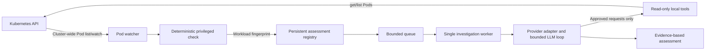

# Kubernetes Security Agent

This project is a deliberately small, read-only Python agent for exploring how
an AI model can investigate a Kubernetes security finding without deciding what
the finding is. Deterministic Python code detects a container configured with
`securityContext.privileged: true`; the model can then request a limited set of
read-only Kubernetes facts and produce an evidence-based assessment.
The watcher covers Pods across the cluster so the model can distinguish a
recognizable system component from a privileged workload that merits review.

This is an educational lab, not a production security control. The related
CloudSecBurrito walkthrough is not published yet. When it exists, this README
will link to it; the article will own the executable setup sequence, observed
output, interpretation, validation, and cleanup walkthrough.

## Architecture



The watcher handles Kubernetes events and never calls an LLM provider. It places new
findings on a bounded queue, and a separate worker performs investigations one
at a time. The registry resolves controller ownership, records assessments in a
local JSON state file, and suppresses an unchanged workload fingerprint across
Pod replacements and agent restarts.

## Checked-in Artifacts

| Path | Purpose |
| --- | --- |
| `agent/` | Watcher, detector, registry, read-only tools, agent loop, and CLI |
| `tests/` | Unit tests that use no live cluster or external LLM API |
| `manifests/namespace.yaml` | Dedicated namespace with deliberately permissive Pod Security Admission |
| `manifests/rbac.yaml` | Cluster-wide Pod `get`, `list`, and `watch` access for `ai-investigator` |
| `manifests/privileged-pod.yaml` | Intentionally privileged test Pod pinned to an image digest |
| `example.env` | Non-secret configuration template |
| `.gitignore` | Project-local exclusions for environments, logs, caches, and build output |

## Runtime and Dependencies

The project requires Python 3.12 or newer. `pyproject.toml` pins the Kubernetes
Python SDK, the SDK used by the first OpenAI provider adapter, `python-dotenv`,
the build backend, and the test runner. A project-local virtual environment is
the intended installation boundary:

```bash
python3 -m venv .venv
.venv/bin/python -m pip install --upgrade pip
.venv/bin/python -m pip install -e '.[test]'
```

The agent has four entry points:

```bash
python -m agent.main watch
python -m agent.main investigate --namespace ai-lab --pod risky-pod
python -m agent.main inventory
python -m agent.main acknowledge --record-id RECORD_ID --reason "Reviewed component"
```

Both paths use the same deterministic detector and investigator. Manual mode
does not manufacture a finding when the selected Pod has no privileged
container.

## Configuration

Copy `example.env` to a local `.env` or provide the same values in the process
environment. `.env` files, kubeconfigs, private keys, certificates, and logs are
ignored by the repository and must remain local.

| Variable | Default | Meaning |
| --- | --- | --- |
| `LLM_PROVIDER` | `openai` | Investigation adapter; only `openai` is implemented in this iteration |
| `LLM_MODEL` | none | Provider model with tool calling and structured-output support; required when `DRY_RUN=false` |
| `LLM_REASONING_EFFORT` | `low` | Provider reasoning budget for one investigation |
| `LLM_MAX_OUTPUT_TOKENS` | `2048` | Hard ceiling covering visible output and provider reasoning tokens |
| `OPENAI_API_KEY` | none | Provider-specific credential required when `LLM_PROVIDER=openai` |
| `KUBECONFIG` | none | Required path to the dedicated `ai-investigator` kubeconfig |
| `WATCH_LABEL_SELECTOR` | none | Optional cluster-wide server-side Pod selector |
| `DRY_RUN` | `true` | Detect and log findings without calling an LLM provider |
| `INVESTIGATION_COOLDOWN_SECONDS` | `300` | Duplicate-suppression interval |
| `MAX_TOOL_CALLS` | `2` | Hard limit for one model investigation |
| `AGENT_STATE_FILE` | `state/assessments.json` | Persistent workload assessment inventory |
| `STATE_OBSERVATION_FLUSH_SECONDS` | `60` | Coalescing interval for duplicate last-seen/count writes; `0` writes every observation |
| `AGENT_LOG_FILE` | none | Optional rotating JSON log file path |
| `AGENT_LOG_MAX_BYTES` | `5242880` | Maximum size of the active log file |
| `AGENT_LOG_BACKUP_COUNT` | `3` | Number of rotated log files retained |

Start in dry-run mode. A missing API key is therefore not an error until the
operator explicitly enables model calls. A dedicated kubeconfig is required in
both modes so the application cannot silently inherit an administrator context.

## LLM Provider Boundary

The Kubernetes watcher, deterministic detector, registry, approved tools, and
assessment schema do not depend on a particular model provider. They consume a
small `Investigator` protocol that accepts a finding and returns a structured
assessment. The current `OpenAIInvestigator` is the first adapter and implements
the bounded Responses API tool loop.

This is an extension boundary, not a claim that every provider is already
supported. A second adapter must translate the same two tool definitions,
enforce the same call limit, and return the same `SecurityAssessment` schema
before it can be selected through `LLM_PROVIDER`.

## Kubernetes Identity and Access Boundary

The intended external client identity is the certificate subject
`CN=ai-investigator`. A cluster administrator must create its private key and
client certificate outside this repository, configure a dedicated kubeconfig
that points at the target cluster, and bind that identity using
`manifests/rbac.yaml`. Do not reuse an administrator kubeconfig.

The application refuses to start without an explicit kubeconfig, disables SDK
credential persistence, and logs the selected kubeconfig path, context, cluster,
user alias, and API target without logging credential material.

The checked-in ClusterRole grants Pod `get`, `list`, and `watch` across every
namespace. It also grants `get` on ReplicaSets and Jobs so deterministic Python
can trace a Pod to its top-level Deployment or CronJob. Pods owned directly by
a DaemonSet or StatefulSet need no extra controller read. The identity still
cannot read Secrets or ConfigMaps, create resources, update workloads, or
perform remediation. The local tool dispatcher validates namespace and Pod
names before each request. Kubeconfig contents and authentication material are
never included in prompts.

Cluster-wide Pod visibility is materially more sensitive than the original
`ai-lab`-only design. Pod specifications can reveal images, service accounts,
node placement, and workload structure. Only concise, sanitized summaries are
sent to the configured LLM provider; environment variables, mounted data,
tokens, Secret contents, and arbitrary labels or annotations are omitted.

The walkthrough will document the environment-specific certificate signing and
kubeconfig commands. Generated keys, certificates, certificate requests, and
kubeconfigs do not belong in Git.

## Lab Resources and Risk

`manifests/namespace.yaml` explicitly sets Pod Security Admission enforcement
to `privileged` and pins the policy labels to Kubernetes `v1.36`. That choice
exists only so the intentionally unsafe test Pod can run. **Do not use this
namespace policy or test Pod in production.** Use an isolated, disposable
cluster and review all manifests before applying them. Update the pinned policy
version only when the lab is deliberately revalidated on a newer Kubernetes
minor version.

`manifests/privileged-pod.yaml` grants its container the host-level capabilities
associated with a privileged container. It does not mount a host path, but the
detector reports host-path volumes as extra context when a detected Pod has
them. Removing the Pod and namespace is part of the lab cleanup. The
ClusterRole and ClusterRoleBinding are cluster-scoped and must be removed
separately when the agent identity is retired.

## Investigation Flow

The watch path lists Pods across all namespaces, records the cluster-wide list
resource version, and processes `ADDED` and `MODIFIED` events. Watch timeouts
reconnect using the last observed resource version. An expired resource version
causes a fresh list before the watch resumes.

The only initial trigger is an explicit `privileged: true` value. The model does
not decide whether a container is privileged. Each finding contains the
namespace, Pod name and UID, container name, reason, container type, privileged
value, host-path context, resolved workload identity, and deterministic
fingerprint.

Python resolves Pod ownership as follows:

- Pod to DaemonSet or StatefulSet directly
- Pod to ReplicaSet to Deployment
- Pod to Job to CronJob
- A Pod without a controller remains a standalone Pod

The watcher first performs the local privileged check, so ordinary Pod events
never trigger owner-resolution API calls. Successful ReplicaSet and Job owner
lookups are retained in a bounded in-process cache keyed by owner UID.

The fingerprint includes the resolved workload UID, container name and type,
declared image, security context, service account, host
namespace settings, and host-path volumes. An identical fingerprint reuses its
stored assessment. A changed image, security setting, controller UID, or other
fingerprinted evidence creates a new investigation record.

For a non-dry-run investigation, the model may request only:

- `get_pod_details(namespace, pod_name)`
- `get_namespace_pods(namespace)`

These local functions return concise Pod data rather than full Kubernetes API
objects. Regular, init, and ephemeral containers use the same grouping logic as
the deterministic detector so tool evidence cannot omit a detected container.
Namespace summaries return at most 50 Pods, prioritize privileged Pods, and
report the total count and whether the result was truncated.
The summaries intentionally omit environment variables, mounted data,
kubeconfig material, tokens, Secret contents, labels, and annotations. A Pod
summary includes owner references, service account, images, node placement,
host namespace settings, security contexts, and host-path volumes so the model
has evidence beyond the namespace name.

Registry-only identifiers, including fingerprints and Kubernetes UIDs, are not
sent to the provider. Tool JSON omits null fields and uses compact encoding.
Each provider response contributes input, cached-input, cache-write, output,
reasoning, and total-token counts to one structured usage log for the complete
investigation; prompt or tool content is not included in that usage record.

The model returns one structured disposition:

- `expected_system_component`: evidence supports privilege as part of a
  recognizable cluster component.
- `review_warranted`: the privilege is unexplained, unusual, or combined with
  evidence that merits human review.
- `likely_acceptable`: evidence supports an intentional non-system use, without
  claiming that the workload is safe.
- `insufficient_evidence`: the observations do not justify another result.

The namespace contributes context, but `kube-system` is never an automatic
allowlist. A privileged setting alone is not treated as proof that a workload
is malicious, and a familiar namespace alone is not treated as proof that it is
safe.

## Persistent Inventory and Acknowledgments

`AGENT_STATE_FILE` stores the running workload inventory as JSON. Updates use an
atomic file replacement and an interprocess file lock so a foreground watcher
and management commands reload each other's changes. The state and lock files
are permissioned `0600`. The inventory records the resolved workload,
fingerprint, assessment, first and last observation, observation count, latest
Pod name, and any human acknowledgment. The state directory is excluded from
Git.

Dry-run findings are stored as `observed`. Starting the agent later with
`DRY_RUN=false` promotes those records into real investigations. Completed
assessments remain suppressed while their fingerprint is unchanged. Failed or
interrupted investigations retry only after the configured cooldown.
State transitions are persisted immediately; repeated observations only flush
their latest timestamp and count at the configured interval. Duplicate watch
events are logged at debug level instead of producing repeated warnings.

`inventory` prints all records and can filter by disposition or show only
human-acknowledged records with `--acknowledged-only`. `acknowledge` accepts a
unique record-ID prefix, a required human reason, and an optional
`--review-after` date or timestamp. Only observed or completed records can be
acknowledged. An expired acknowledgment reopens the exact record for
investigation. A model disposition never acknowledges or ignores a workload
automatically.

## Execution Model

This iteration runs as a foreground process on the operator's workstation. It
does not install a background service, run as root, or deploy into Kubernetes.
The application can write structured JSON to `AGENT_LOG_FILE` with bounded log
rotation, while `AGENT_STATE_FILE` preserves assessments across foreground
restarts.

A standalone macOS LaunchAgent was tested but is not a supported path here:
macOS local-network privacy blocked its connection to the lab API server even
though the same interpreter and kubeconfig worked from Terminal. Packaging and
signing a native macOS service would expand this lab in the wrong direction.
Container packaging is intentionally deferred to a later iteration.

## Validation Boundary

The unit tests cover privileged and nonprivileged regular, init, and ephemeral
containers; workload and fingerprint resolution; persistent duplicate
suppression; changed fingerprints; acknowledgment expiry; dry-run promotion;
coalesced state writes; cached owner resolution; bounded namespace summaries;
cooldown retry; kubeconfig fail-closed behavior; resource-version relisting;
queue overflow; bounded log rotation; and invalid tool arguments without
network access. They do not prove connectivity, authentication, RBAC, model
availability, launchd runtime behavior, or end-to-end lab behavior.

An end-to-end validation requires a dedicated kubeconfig to authenticate as
`ai-investigator`, a cluster-wide Pod watch, creation of the privileged test
Pod in `ai-lab`, exactly one investigation during the cooldown, optional model
tool calls, a structured evidence-based disposition, restart persistence, and
re-investigation after a fingerprint change. The related CloudSecBurrito
walkthrough owns observed commands, output, interpretation, and teardown
evidence; this README does not substitute for that environment-specific record.

## Known Limitations

- The JSON state file assumes one agent process; it is not distributed state or
  multi-process coordination.
- Historical fingerprints remain in the inventory and can grow over time; no
  automatic retention policy is implemented yet.
- An interrupted `in_progress` record becomes retryable after its cooldown.
- A single worker intentionally limits throughput.
- The initial cluster-wide list can enqueue many existing privileged containers;
  keep `DRY_RUN=true` until that inventory is understood.
- Cooldown suppresses repeated identical keys but does not provide distributed
  coordination.
- Detection is limited to explicit privileged container configuration.
- The tool summaries are intentionally incomplete and may leave uncertainty.
- The agent has no remediation, mutation, shell execution, MCP, gateway,
  container image, distributed state, multi-agent behavior, or telemetry stack.
- Kubernetes and provider-adapter failures are logged, but persistent orchestration and
  alert delivery are future concerns.

## Logging and Sensitive Data

Logs are structured JSON and include watch connections, detections,
investigation lifecycle, tool outcome status, API failures, and counters. An
assessment may contain Pod metadata returned by the approved tools. Treat log
files as potentially sensitive operational data. The application never logs
the API key, kubeconfig contents, authentication tokens, or environment dump.
